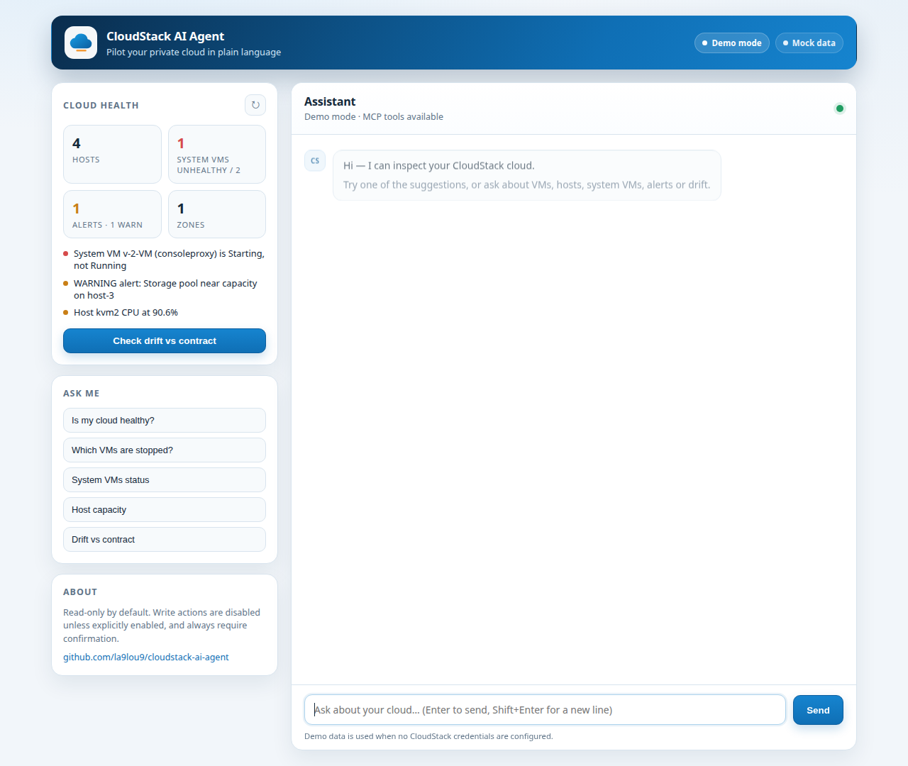

# CloudStack AI Agent

A LangGraph agent that manages **Apache CloudStack** in plain language.

```
LangGraph agent  →  MCP client  →  CloudStack MCP server  →  CloudStack API
```

The agent never calls CloudStack directly and never runs shell commands. It
only sees a small, typed set of tools exposed over the
[Model Context Protocol](https://modelcontextprotocol.io). That split is the
whole design:

- **the MCP server** is the only component that talks to CloudStack;
- **the agent** decides which tools to call and explains the result;
- **safety** (read-only default, write opt-in, confirmation) lives in the
  tool layer, not in a prompt.

## Why two layers?

| Layer | Testable alone | Reusable | Safety |
|---|---|---|---|
| MCP server | Yes — no LLM needed | Any MCP client (Claude, Cursor, …) | Allowlist + confirmation in one place |
| LangGraph agent | Yes — mock tools/LLM | Can change model/provider freely | Cannot call a tool that is not exposed |

Building the MCP server first also means there is something useful to demo
before any model/API key is involved: `--check` prints a real health summary
from the built-in mock data.

## Quickstart (no CloudStack, no LLM)

```bash
cd cloudstack-agent
python3 -m venv .venv && source .venv/bin/activate
pip install -r requirements-dev.txt   # or just: pip install pytest (core uses stdlib)

# Mock mode is the default when credentials are missing.
python -m cloudstack_agent.cli --check
python -m cloudstack_agent.drift --contract examples/deployment.yaml
pytest -q
```

`--check` returns something like:

```json
{
  "healthy": false,
  "zones": {"total": 1, "names": ["lab-zone"]},
  "hosts": {"total": 3, "down": 0},
  "system_vms": {"total": 2, "unhealthy": 1},
  "alerts": {"total": 1, "warning": 1, "critical": 0},
  "issues": [
    "System VM v-2-VM (consoleproxy) is Starting, not Running",
    "WARNING alert: Storage pool near capacity on host-3",
    "Host kvm2 CPU at 90.6%"
  ]
}
```

## Connect to a real CloudStack

```bash
cp .env.example .env
# fill in CLOUDSTACK_URL / CLOUDSTACK_API_KEY / CLOUDSTACK_SECRET_KEY
# and set CLOUDSTACK_MOCK=false
```

`.env` is loaded automatically when `python-dotenv` is installed (it is in
`requirements.txt`); otherwise export the variables yourself.

The client signs requests with CloudStack's classic API signature
(sorted + URL-encoded params, lowercased canonical string, HMAC-SHA1,
base64). Set `CLOUDSTACK_VERIFY_TLS=false` only for a lab with a self-signed
certificate.

## Run the MCP server

```bash
python -m cloudstack_agent.mcp_server
```

### Claude Desktop / Cursor

```json
{
  "mcpServers": {
    "cloudstack": {
      "command": "python",
      "args": ["-m", "cloudstack_agent.mcp_server"],
      "env": {
        "CLOUDSTACK_MOCK": "true"
      }
    }
  }
}
```

Point `command` at the virtualenv's Python if needed, and use the same
environment variables as the CLI.

## Chat UI (demo without an LLM)



```bash
pip install -r requirements.txt
python -m cloudstack_agent.web
# open http://127.0.0.1:8080
```

The page uses a CloudStack-inspired palette and works immediately with the
mock backend:

- no API key required — a deterministic demo responder answers health, host,
  VM, system VM, alert and drift questions;
- the sidebar shows live health (hosts, system VMs, alerts, zones);
- "Check drift vs contract" renders the drift report;
- it switches to the real LangGraph agent automatically when a provider key
  is present, or force it with `CLOUDSTACK_AGENT_USE_LLM=always`.

The server binds to `127.0.0.1` by default and has no authentication — keep it
local, or put it behind your own auth/proxy if you expose it.

## Run the agent

Install a provider package and pick a model:

```bash
pip install langchain-openai
export OPENAI_API_KEY=...
export CLOUDSTACK_AGENT_MODEL=openai:gpt-4o-mini

python -m cloudstack_agent.cli "is my cloud healthy?"
python -m cloudstack_agent.cli "which VMs are stopped, and why did the console proxy fail?"
```

The agent loads its tools from the MCP server over stdio, so it uses exactly
the same tool contract as any other MCP client.

## Drift detector (contract vs reality)

The detector compares one `deployment.yaml` contract with the live state of
the one CloudStack zone that contract owns. It is read-only and returns a
report plus an exit code:

```bash
python -m cloudstack_agent.drift --contract examples/deployment.yaml
python -m cloudstack_agent.drift --contract examples/deployment.yaml --json
```

```
DRIFT DETECTED — tenant-demo / dep-lab-demo (zone lab-zone, id zone-1)
17 checks, 1 error(s), 0 warning(s)
  ✘ system_vm_not_running: system VM 'v-2-VM' (consoleproxy) is Starting, not Running
```

(The mock data deliberately contains one unhealthy system VM so the demo
shows a real finding. Point `--contract` at a matching/clean contract, or
adjust the mock, to get `NO DRIFT`.)

Exit code `0` = no drift, `1` = drift, `2` = bad contract/path. It checks
zones, pods, clusters, hosts, system VMs, IP ranges, public VLAN, storage
pools and the CloudStack version.

**Scope / multi-client:** every resource query is filtered by the zone id
resolved from the contract, and resources are matched inside that zone only.
One contract = one tenant + one deployment + one zone, so two clients with
the same names cannot be mixed. For stronger isolation, tag CloudStack
resources with `deploymentId` (or use a CloudStack domain/account per tenant).

Set `CLOUDSTACK_AGENT_CONTRACT_DIR` to restrict which contract files the MCP
tool is allowed to read.

## Tools

**Read-only (always available)**

`list_zones`, `list_hosts`, `list_virtual_machines`, `get_virtual_machine`,
`list_system_vms`, `list_networks`, `list_alerts`, `list_events`,
`list_templates`, `list_service_offerings`, `list_volumes`, `cloud_health`,
`drift_report`

**Write (opt-in via `CLOUDSTACK_AGENT_ALLOW_WRITE=true`, and `confirm=true`)**

`start_virtual_machine`, `stop_virtual_machine`, `reboot_virtual_machine`

Write tools are **not registered** in the MCP server unless the setting is
enabled. Even then, a call without `confirm=true` only returns
`confirmation_required`; it does not execute anything.

## Safety model

- Read-only by default.
- Write tools are opt-in and per-call confirmed.
- No free-form shell, no raw API calls from the model.
- The agent never sees CloudStack credentials — only the MCP server does.
- Outputs are compact, filtered views (not full API payloads), which also
  keeps the model's context small.
- Mock mode makes demos and tests deterministic.

## Project layout

```
cloudstack-agent/
  cloudstack_agent/
    config.py              environment settings
    cloudstack/client.py   stdlib CloudStack client + signing + mock fixtures
    tools/read.py          read-only, typed tool functions
    tools/write.py         opt-in write tools with confirmation guard
    drift.py               contract vs live CloudStack drift detector
    demo_chat.py           deterministic replies used by the web UI
    web.py                 FastAPI chat UI server
    web_static/            HTML/CSS/JS chat interface
    mcp_server.py          MCP adapter (FastMCP / MCPServer)
    agent/graph.py         LangGraph ReAct loop over MCP tools
    cli.py                 --check and natural-language CLI
  tests/                   client, tools, write guard, config
```

## Tests

```bash
pytest -q
```

The core tests (client, tools, write guard, config) need only `pytest` — no
CloudStack, no LLM, no network.

## Status / roadmap

- [x] Typed read-only tool layer + mock backend
- [x] MCP server (read-only)
- [x] LangGraph agent + CLI
- [x] Write tools behind confirmation
- [x] Drift detector: compare a `deployment.yaml` contract with live state
- [x] FastAPI chat UI with a no-LLM demo mode
- [ ] MCP resources/prompts (instead of tools only)
- [ ] Persistent checkpointer (SQLite/Postgres) + audit log
- [ ] Integration tests against a real CloudStack lab

## CV line

> Built a LangGraph agent and an MCP server that manage Apache CloudStack in
> natural language, with typed tool calls, a read-only default, human
> confirmation for write actions, and a mock backend for deterministic tests.
